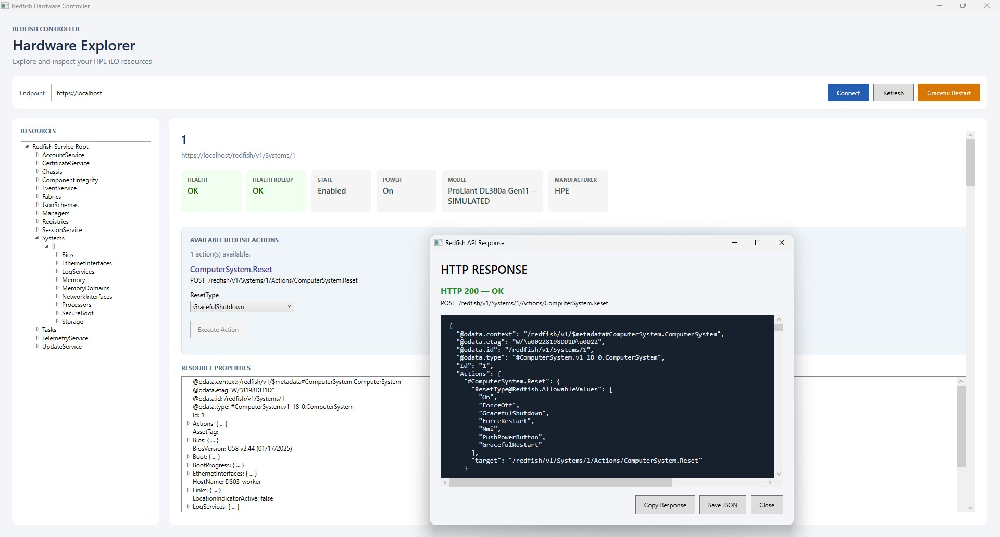

# RedfishController

A Windows desktop application built with C# and .NET WPF for discovering and inspecting server hardware resources through the DMTF Redfish REST API.

Developed and tested using the HPE iLO Redfish Emulator.

## Screenshot



## Features

- Connect to a local Redfish API endpoint
- Discover systems, chassis, managers, and other resources dynamically
- Navigate Redfish resource collections through an expandable tree
- Display hardware health, power state, and device information
- Explore nested JSON properties
- View formatted raw API responses
- Refresh resource information

## Technologies

- C# / .NET 11 (preview SDK)
- Windows Presentation Foundation (WPF)
- HttpClient
- System.Text.Json
- Redfish REST API
- Docker

## Getting Started

### Prerequisites

- Windows
- Compatible .NET SDK
- Docker Desktop
- [HPE iLO Redfish Emulator](https://github.com/HewlettPackard/ilo-redfish-emulator)

### 1. Start the emulator

Follow the emulator repository's installation instructions.

From the emulator directory, run:

```powershell
docker compose up -d
```

### 2. Configure credentials

In PowerShell:

```powershell
$env:REDFISH_USERNAME = "root"
$env:REDFISH_PASSWORD = "root_password"
```

These are the emulator's sample credentials, not production credentials.

### 3. Launch RedfishController

From the application directory:

```powershell
dotnet restore
dotnet run
```

Enter `https://localhost` and click **Connect**.

## Security

This application is currently a local development prototype.

The implementation temporarily bypasses TLS certificate validation for emulator testing and restricts connections to local HTTPS endpoints. It is not ready for production hardware.

## Planned Improvements

- Dedicated Redfish API client class
- Hardware overview dashboard
- Enhanced resource navigation
- Hardware sensor and event log support
- Secure authentication and certificate validation
- Automated tests and CI/CD

## Project Purpose

This project explores hardware management through REST APIs while developing practical experience with C#, .NET, asynchronous programming, JSON processing, and desktop application development.

## Disclaimer

This is an independent educational project and is not affiliated with Hewlett Packard Enterprise. Hardware data returned by the emulator is simulated.
